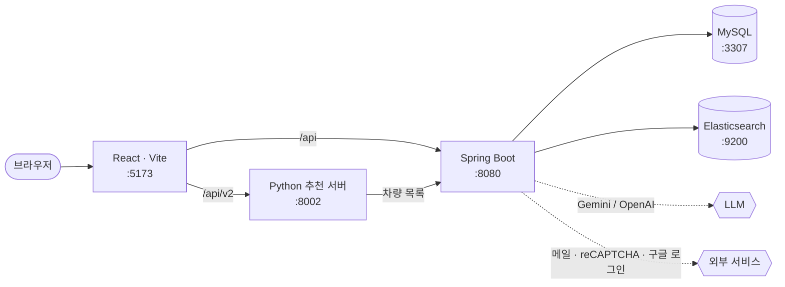

# Final_Project

재무 진단과 차량 추천, 콤파 챗봇, 1:1 상담, 관리자 화면을 제공하는 웹 서비스입니다.

## 아키텍처



점선은 키를 넣었을 때만 쓰는 외부 연동입니다. Kibana(:5601)는 Elasticsearch 확인용으로 함께 뜹니다.

| 폴더 | 역할 |
|---|---|
| `front/` | React 화면 (Vite) |
| `back/` | Spring Boot API · DB 마이그레이션 |
| `ml/` | 추천 모델 학습 · 추론 API (Python) |
| `tools/data/` · `data/` | 데이터 수집 · 생성 코드와 데이터 |
| `docker/` · `docker-compose.yml` | MySQL · Elasticsearch · Kibana |
| `docs/` | 개발 문서 |

자세한 구조는 [프로젝트 구조](docs/structure.md)를 참고하세요.

## 실행

Docker, JDK, Node.js 가 필요합니다. 추천 서버까지 켜려면 [ML 초기 준비](ml/README.md)도 합니다.

```powershell
.\dev.ps1        # Windows: DB · ES · Spring · React · 추천 서버 전체 (dev.cmd 도 같음)
```

```bash
./dev.sh         # Git Bash · macOS: DB · ES · Spring · React (추천 서버 제외)
```

```bash
docker compose up -d                          # 직접 실행: DB · ES
cd back && ./gradlew bootRun                  # 백엔드
cd front && npm install && npm run dev        # 프론트
```

프론트 http://localhost:5173 · 백엔드 http://localhost:8080

### 키 (선택)

키 없이도 개발 모드로 동작합니다. 메일 · reCAPTCHA · 구글 로그인 · LLM 키를 쓸 때만 프로젝트 루트에서 키 파일을 만들어 채우고, 서버 · 프론트를 다시 켭니다.

```bash
cp .env.example .env.local                  # Git Bash · macOS
```

```powershell
Copy-Item .env.example .env.local           # Windows PowerShell
```

키별 설명과 발급처는 `.env.example` 주석과 [개발 가이드](docs/development.md#외부-서비스-키)에 있습니다.

## 문서

- [개발 가이드](docs/development.md) — 실행 옵션, 외부 서비스 키, DB 스키마, CI
- [프로젝트 구조](docs/structure.md)
- [추천 화면과 API](docs/recommendation.md) · [ML 안내](ml/README.md) · [데이터 도구](tools/data/README.md)
- [챗봇](docs/chatbot.md) · [관리자 화면](docs/admin-ui.md)
- [DB 스키마 변경](back/SCHEMA.md)
